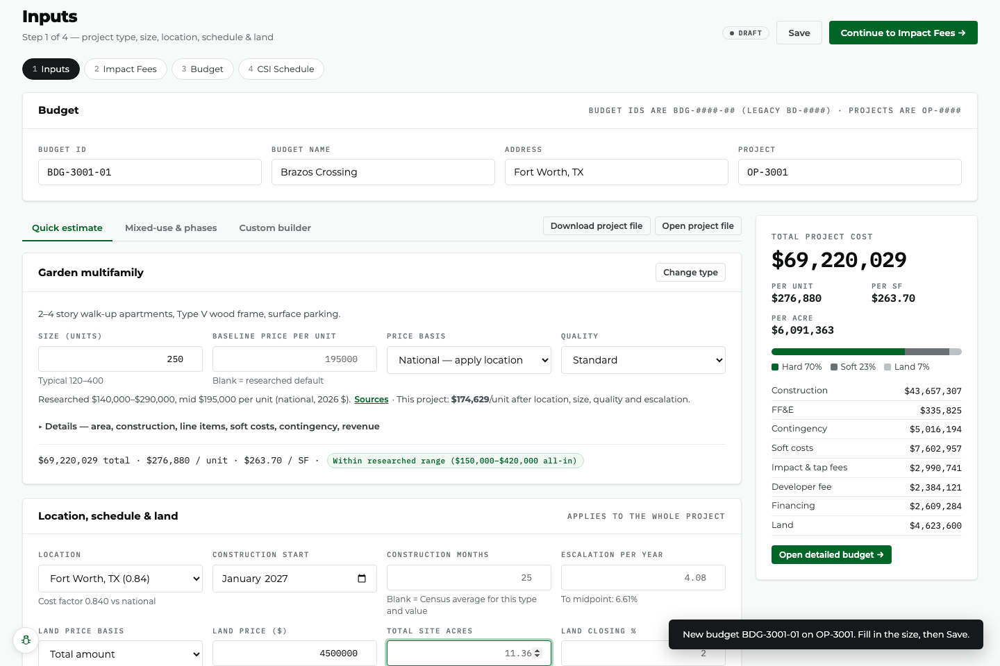

# Estimates — user guide

An **estimate** is a budget built from researched costs for almost any kind of real-estate
project. You describe the project; the Budgeting Suite prices it line by line and shows
where every number came from.

## Start one (under a minute)

1. **Home → + New Budget → Estimate Any Project Type.**
2. Pick the project, check the Budget ID, **Create Budget**.
3. The type picker opens. Search ("RV", "hotel", "marina", "data center") or browse by
   category, and pick one.
4. Enter the **size** in the type's unit — SF for buildings; units, keys, beds, pads,
   sites, slips, spaces, courts, bays, kW, MW or MWh for the rest.
5. The total appears on the right. That's a complete budget.

Everything else is optional and has a researched default:

| Field | What it does |
|---|---|
| **Baseline price per unit** | Blank = the researched mid (national, current dollars, standard quality, typical size). The help line shows the researched low–high and a **Sources** link. Type your own to override. |
| **Price basis** | *National* applies the location factor to the price; *Already local* uses your number as-is (use it when your price came from a local bid). |
| **Quality** | Economy / Standard / Premium / Luxury multipliers from the research. |
| **Location** | 98 metros and every state. The cost factor is shown under the box. |
| **Construction start / months** | Blank months = the Census average for this kind of project at this cost. Costs escalate to the construction midpoint. |
| **Land** | Total, per acre or per unit; closing costs and due diligence are added. |
| **Construction loan** | Loan-to-cost, rate and fee. Interest is computed month by month from the draw schedule and capitalized. |
| **Developer fee** | % of cost before the fee, financing and land. |

**Details** (under each component) opens: building SF and site acres overrides,
construction type and stories, added parking, FF&E on/off, the type's specialty and fixed
items (e.g., grease interceptor, utility pedestals, bathhouse, docks, tunnel equipment) —
switch optional ones on or set quantities — soft cost %, contingencies, and **revenue**
for the pro forma.

## Mixed-use and phases

Switch to **Mixed-use & phases**:

- **+ Add component** for each use (residential, retail, hotel, parking…). Each has its own
  type, size, price, quality and phase.
- **Shared elements** are built once and split: choose a building block (a garage, roads,
  detention, an amenity center…) or enter a unit cost, a quantity, the phase it is built
  in, and how to split it — by building SF, primary units, revenue, direct cost, equally,
  or by manual %. The split always adds up to the penny.
- **Phases** each have a start, length, draw curve and construction loan. A phase with
  no start begins when the one before it ends. The timeline shows them side by side.

Totals are shown per component, per phase and for the whole project — and they add up.

## Custom builder

For anything no template fits: **Custom builder → Start a custom component**, then add
building blocks (search "metal building", "site work", "pool", "dock", "solar"…) with
quantities, or **Your own priced item**. Soft costs, contingency, fees and financing are
added the same way as any template. You can mix a custom component with templated ones.

## The detailed budget (Budget page)

- **Budget detail:** component → phase → CSI division → line. Every line has an amount you
  can type over; edited lines turn blue and get a **reset** link. Overrides flow through —
  change a hard-cost line and contingency, soft costs and the developer fee follow.
- **Source badges:** *Sourced* (a published number), *Derived — verify* (reasoned from
  comparables; check it), *Computed* (financing, allocations), *Edited* (yours). Click a
  badge for the full trail: the research file, method, normalization, and each source with
  its quote and link.
- **Draw schedule:** monthly hard, soft and land spending, equity, loan draws, interest and
  balance per phase.
- **Scenarios:** add scenarios that change quality, baseline price, escalation, soft cost
  %, contingency or land, and compare them side by side with the base.
- **Sensitivity:** each driver moved alone (price ±10%, quality ± a tier, soft cost, escalation,
  contingency, loan rate, duration, land), ranked by impact.
- **Sources & assumptions:** every factor applied and every source used.
- **Warnings:** a component whose all-in cost per unit falls outside the researched range
  for its type is flagged on the Inputs panel and here.

## Pro forma

On the Budget page, pick **Whole project**, a **component** or a **phase** and **Create pro
forma →**. The budget is saved first; the new investment analysis takes that slice's total
cost as its purchase price, its building SF (or units) as size, and the revenue you
entered on the components (rate, other income, vacancy, operating expense %). Re-sync later
keeps the same slice. Enter revenue under **Details → Revenue** on each component.

## Exports and files

- **Excel / PDF** (Budget page): summary, components, phases, line detail, draw schedules,
  sources & assumptions. The header **Export** still produces the classic budget report from
  the same numbers.
- **Download project file / Open project file** (Inputs page): the estimate's inputs as a
  `.estimate.json` file — keep it offline or start another budget from it.

## When the research is updated

A saved estimate keeps its numbers. If the app ships newer research, a banner shows the
saved total and what current research would give; your numbers change only when you edit
the estimate or click **Update to current research**.

## Impact fees

Estimates include national-average impact and water/sewer capacity fees for the type's land
use. They vary enormously by city — pick the jurisdiction on the **Impact Fees** step and
its schedule replaces the estimate.
